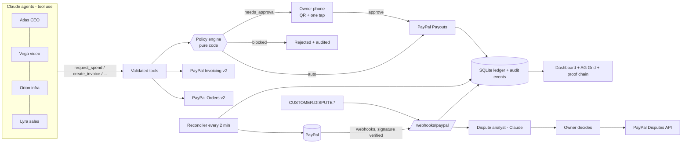

# Atlas Treasury

**A PayPal-native treasury for a company run by AI agents.**
Agents *earn* (PayPal Invoicing, Orders checkout), *spend* inside budgets (PayPal Payouts), and every out-of-policy payment waits for **one tap from the human owner on a phone**. Every payment is linked to the task that caused it and the result it produced. Refunds and disputes are triaged by an agent and decided by the human.

> **The LLM proposes, the policy engine disposes, the human signs.**
> Money rules are deterministic code (`src/policy.js`), never the model.

Sandbox only - it never touches real money. MIT licensed.

## Judge's tour (60 seconds, no install)

Live sandbox stand: **https://treasury.ihor.work** (PayPal sandbox + Claude configured; no real money).

| # | Open | What you see |
|---|---|---|
| 1 | [Overview](https://treasury.ihor.work/#/overview) | Four agents with budget bars, earned / spent / ROI, KPI tiles and a "Run agent" box per agent |
| 2 | [Approvals](https://treasury.ihor.work/#/approvals) | Pending payments with a QR code. Scan it or click through to the mobile approval page `/approve/<token>`: agent, amount, vendor, policy reasons, budget after payment, Approve / Reject |
| 3 | [Ledger](https://treasury.ihor.work/#/ledger) | AG Grid with every money movement. Click a row for the proof chain: task -> spend request -> policy verdict -> human decision -> PayPal ids -> webhook events -> delivered result |
| 4 | [Invoices](https://treasury.ihor.work/#/invoices) | Real PayPal sandbox invoices created by an agent, payer links, status |
| 5 | [Timeline](https://treasury.ihor.work/#/timeline) | Tool-by-tool transcripts of agent runs (what Claude called, what the policy engine answered) |
| 6 | [Disputes](https://treasury.ihor.work/#/disputes) | Dispute list with the AI analysis; PayPal's Disputes API is called only after a human click |
| 7 | [Audit](https://treasury.ihor.work/#/audit) | Every webhook / agent / human / policy event, with the signature-verified flag |
| 8 | [Ask](https://treasury.ihor.work/#/ask) | The treasurer answers questions from the ledger and cites row ids |

Try it: on Overview give an agent an instruction such as "Order voice-over for $45" - the amount is above that agent's auto limit, so a card appears under Approvals instead of money moving. (AI runs are rate limited per visitor, see Safety.)

**Pay an invoice as a buyer** (sandbox test account, fake credentials, safe to publish): open an invoice's payer link from [Invoices](https://treasury.ihor.work/#/invoices) and log in at https://www.sandbox.paypal.com with

- email: `sb-6js4853607020@personal.example.com`
- password: `7.TIj>6<`

### What was verified live against the PayPal sandbox (29 Oct 2026)

- Agent Orion asked for $38 to a **new vendor**; the policy engine flagged "New vendor" and sent it to the owner; the owner approved on the phone page; PayPal Payouts accepted the batch (`6HSPCYLSWWX8Q`).
- Agent Lyra declined to re-invoice a task that was already paid (the model's own double-billing guard); Orion noticed a possible duplicate GPU payment for one task and warned the owner.
- Agent Vega created and sent a real sandbox invoice through Invoicing v2. Along the way we found PayPal accepts only `NET_10/15/30/45/60/90` terms, so the client sends an explicit due date instead (`src/paypal.js: createInvoice`).

## Architecture



## PayPal APIs used (and where)

| API | Calls | File |
|---|---|---|
| Invoicing v2 | generate-next-invoice-number, create, send, get, remind, record payment (explicit "client paid offline" button), cancel | `src/paypal.js`, `src/treasury.js` |
| Orders v2 | create (intent CAPTURE, `custom_id` = task id), capture, get | `src/paypal.js`, `src/treasury.js` |
| Payments v2 | refund capture | `src/paypal.js`, `src/disputes.js` |
| Payouts v1 | create batch (`sender_item_id` = our spend request id), get batch | `src/treasury.js`, `src/reconcile.js` |
| Disputes v1 | list, get, accept-claim, provide-evidence, send-message | `src/paypal.js`, `src/disputes.js` |
| Webhooks | `verify-webhook-signature`, list/create webhook (`npm run setup:webhook`) | `src/webhooks.js`, `src/setup-webhook.js` |

Engineering details judges may care about: every POST carries a `PayPal-Request-Id` (idempotency); webhook events are stored verbatim and deduplicated on `event.id`; the ledger has a unique index on `(kind, paypal_ref_type, paypal_ref_id)` so the webhook and the reconciler can never double-book; approval tokens are single-use, expire after 48 h, and are claimed atomically before any network call.

## Where each PayPal call lives (function level)

- Invoicing: `src/paypal.js: createInvoice / sendInvoice` driven by `src/treasury.js: createTaskInvoice`; reminders in `remindInvoice`.
- Orders: `src/paypal.js: createOrder` driven by `src/treasury.js: createCheckoutLink`, capture in `captureCheckout`.
- Payouts: `src/treasury.js: executePayout` (called only after the policy verdict or the owner's approval); results land in `settlePayout`, polled by `src/reconcile.js: reconcile`.
- Webhooks: `src/paypal.js: verifyWebhookSignature`, `src/webhooks.js: handleWebhook / applyEvent`.
- Disputes: `src/treasury.js: upsertDispute`, human decision in `src/disputes.js: decideDispute`.

## How AI is used

- **Agents** (`src/agents.js`): one tool-use loop (max 8 tool steps) with a role-specific system prompt. Tools: `get_task`, `list_open_tasks`, `get_budget`, `mark_task_done`, `create_invoice`, `create_checkout_link`, `request_spend`, `send_invoice_reminder`, `query_ledger`. Amounts are validated in code (max $2,000, two decimals). The model never sees credentials and cannot call PayPal directly. An agent can only touch its own tasks.
- **Treasurer**: answers owner questions over the ledger with read-only tools and cites ledger ids.
- **Dispute analyst**: returns structured JSON (`summary`, `evidence_we_have`, `risk`, `recommendation`, `draft_message`); validated, stored, and shown to the human, who decides.
- **Principle - the LLM proposes, the policy engine disposes, the human signs.** `request_spend` only creates a request; `src/policy.js: evaluate` (pure code, unit-tested) returns `auto`, `needs_approval` or `blocked` with human-readable reasons. The model gets the verdict back as the tool result and cannot change it.
- Cost guards for a public demo: `AI_DAILY_CAP` calls/day and 20 AI runs/hour per visitor.

## Run locally in 5 steps

```bash
git clone https://github.com/iphoter-kolosov/atlas-treasury && cd atlas-treasury
npm install                      # Node 22+; uses built-in node:sqlite, no native deps
cp .env.example .env             # DEMO_MODE=1 works with no keys at all
npm test                         # built-in node:test runner
npm start                        # http://localhost:8787
```

With no keys the UI loads with clearly labelled sample data; PayPal/Claude actions answer **503 "PayPal not configured" / "Claude not configured"** - there are no fake success paths. `GET /api/health` shows which integrations are live.

To go live in the sandbox: fill `PAYPAL_CLIENT_ID/SECRET` and `ANTHROPIC_API_KEY`, set `SANDBOX_VENDOR_EMAILS`, expose the app on a public https URL (Render blueprint included, or a tunnel), set `PUBLIC_URL`, then `npm run setup:webhook` and put the printed `PAYPAL_WEBHOOK_ID` into `.env`.

## Sandbox test accounts

Create in the PayPal developer dashboard (Testing Tools -> Sandbox Accounts):

- one **Business** account = the REST app owner (Atlas Corp);
- two or three **Personal** accounts = vendors that agents pay; put their emails into `SANDBOX_VENDOR_EMAILS`;
- one **Personal** account used as the paying client (open an invoice link or checkout link as this buyer).

(Placeholders only - this repo contains no credentials.)

## Layout

```
src/
  server.js          boot, config check, reconciler timer
  app.js             Hono routes, owner auth, rate limits
  config.js          env parsing, "not configured" error
  db.js seed.js      node:sqlite schema, idempotent seed
  policy.js          pure policy engine
  paypal.js          fetch-based PayPal client (injectable fetch)
  treasury.js        spend requests, approvals, invoices, checkout, ledger, disputes, proof chain
  webhooks.js        signature check, dedupe, event -> ledger mapping
  reconcile.js       polls PayPal for anything still pending
  agents.js          Claude tool loop, treasurer, dispute analyst
  disputes.js        human decision on a dispute
public/              vanilla ES modules, AG Grid Community (CDN), mobile-first approval page
test/                node --test: policy, PayPal client (mocked fetch), webhooks, approvals, agents, HTTP
```

## Safety

- The LLM has no PayPal credentials and no direct PayPal access: it can only call the validated tools listed above.
- Hard cap of $2,000 per agent-created request and two-decimal amount validation (`src/money.js`, `src/treasury.js: parseSpendInput`); every spend must be tied to an open task.
- Approval tokens: single-use, expire after 48 h, claimed atomically before any network call.
- Rate limits: 20 AI runs per hour per visitor; `AI_DAILY_CAP` Claude calls per day for the whole stand.
- Failed payouts are recorded with the PayPal error, not hidden.

## Security notes

- Owner actions need `ADMIN_TOKEN` unless `DEMO_MODE=1` (public sandbox demo).
- Approval tokens are the credential on the phone link; they are hidden from anonymous `GET /api/approvals` outside demo mode.
- With `PAYPAL_WEBHOOK_ID` set, unsigned or badly signed webhooks are rejected (400) and not stored. With it empty they are accepted as *unverified* (flagged in the audit trail) - local development only.

## Known limits

- Provide-evidence sends notes as JSON; PayPal documents multipart for file evidence (file upload not implemented).
- Dispute holds are bookkeeping entries; PayPal's own balance is the source of truth for the final outcome.
- The ledger grid uses AG Grid Community, so "group by agent" is an agent filter plus a pinned total row (row grouping is an Enterprise feature).

## License

MIT, see `LICENSE`.
