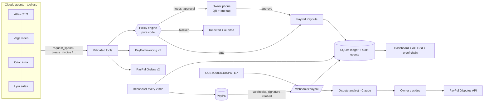

# Atlas Treasury

**A PayPal-native treasury for a company run by AI agents.**
Agents *earn* (PayPal Invoicing, Orders checkout), *spend* inside budgets (PayPal Payouts), and every out-of-policy payment waits for **one tap from the human owner on a phone**. Every payment is linked to the task that caused it and the result it produced. Refunds and disputes are triaged by an agent and decided by the human.

> **The LLM proposes, the policy engine disposes, the human signs.**
> Money rules are deterministic code (`src/policy.js`), never the model.

Sandbox only - it never touches real money. MIT licensed.

## Judges' quick tour (5 minutes)

1. Open the app (`npm start`, or the hosted demo). The Overview shows four agents with budget bars, earned/spent/ROI, and a **pending approval with a QR code**.
2. **Scan the QR** with a phone: a mobile-first approval page shows the agent, amount, vendor, the policy reasons in red and the budget *after* the payment. One tap approves (PayPal Payouts) or rejects.
3. Click **Ledger**, then any row: the **proof chain** goes task -> spend request -> policy verdict -> human decision -> PayPal ids -> verified webhook events -> delivered result.
4. Give an agent an instruction on Overview (needs `ANTHROPIC_API_KEY`), e.g. Vega's "Order voice-over ($45)". Watch the tool-by-tool **Timeline**: the model can only call our tools, and the policy engine routes the $45 to your phone because it is above Vega's $25 auto limit.
5. **Ask** the treasurer: "What did we spend on GPUs this month and what did it produce?" - answered from the ledger with cited row ids.
6. **Disputes**: a `CUSTOMER.DISPUTE.*` webhook creates a dispute; Claude drafts an analysis (evidence we have, risk, recommendation); PayPal's Disputes API is called only after the owner clicks.

## Architecture



## PayPal APIs used (and where)

| API | Calls | File |
|---|---|---|
| Invoicing v2 | generate-next-invoice-number, create, send, get, remind, record payment (explicit "client paid offline" button), cancel | `src/paypal.js`, `src/treasury.js` |
| Orders v2 | create (intent CAPTURE, `custom_id` = task id), capture, get | `src/paypal.js`, `src/treasury.js` |
| Payments v2 | refund capture | `src/paypal.js`, `src/disputes.js` |
| Payouts v1 | create batch (`sender_item_id` = our spend request id), get batch | `src/treasury.js`, `src/reconcile.js` |
| Disputes v1 | list, get, accept-claim, provide-evidence, send-message | `src/paypal.js`, `src/disputes.js` |
| Webhooks | `verify-webhook-signature`, list/create webhook (`npm run setup:webhook`) | `src/webhooks.js`, `src/setup-webhook.js` |

Engineering details judges may care about: every POST carries a `PayPal-Request-Id` (idempotency); webhook events are stored verbatim and deduplicated on `event.id`; the ledger has a unique index on `(kind, paypal_ref_type, paypal_ref_id)` so the webhook and the reconciler can never double-book; approval tokens are single-use, expire after 48 h, and are claimed atomically before any network call.

## How AI is used

- **Agents** (`src/agents.js`): one tool-use loop (max 8 tool steps) with a role-specific system prompt. Tools: `get_task`, `list_open_tasks`, `get_budget`, `mark_task_done`, `create_invoice`, `create_checkout_link`, `request_spend`, `send_invoice_reminder`, `query_ledger`. Amounts are validated in code (max $2,000, two decimals). The model never sees credentials and cannot call PayPal directly. An agent can only touch its own tasks.
- **Treasurer**: answers owner questions over the ledger with read-only tools and cites ledger ids.
- **Dispute analyst**: returns structured JSON (`summary`, `evidence_we_have`, `risk`, `recommendation`, `draft_message`); validated, stored, and shown to the human, who decides.
- Cost guards for a public demo: `AI_DAILY_CAP` calls/day and 20 AI runs/hour per visitor.

## Run locally in 5 steps

```bash
git clone <this repo> && cd atlas-treasury
npm install                      # Node 22+; uses built-in node:sqlite, no native deps
cp .env.example .env             # DEMO_MODE=1 works with no keys at all
npm test                         # built-in node:test runner
npm start                        # http://localhost:8787
```

With no keys the UI loads with clearly labelled sample data; PayPal/Claude actions answer **503 "PayPal not configured" / "Claude not configured"** - there are no fake success paths. `GET /api/health` shows which integrations are live.

To go live in the sandbox: fill `PAYPAL_CLIENT_ID/SECRET` and `ANTHROPIC_API_KEY`, set `SANDBOX_VENDOR_EMAILS`, expose the app on a public https URL (Render blueprint included, or a tunnel), set `PUBLIC_URL`, then `npm run setup:webhook` and put the printed `PAYPAL_WEBHOOK_ID` into `.env`.

## Sandbox test accounts

Create in the PayPal developer dashboard (Testing Tools -> Sandbox Accounts):

- one **Business** account = the REST app owner (Atlas Corp);
- two or three **Personal** accounts = vendors that agents pay; put their emails into `SANDBOX_VENDOR_EMAILS`;
- one **Personal** account used as the paying client (open an invoice link or checkout link as this buyer).

(Placeholders only - this repo contains no credentials.)

## Layout

```
src/
  server.js          boot, config check, reconciler timer
  app.js             Hono routes, owner auth, rate limits
  config.js          env parsing, "not configured" error
  db.js seed.js      node:sqlite schema, idempotent seed
  policy.js          pure policy engine
  paypal.js          fetch-based PayPal client (injectable fetch)
  treasury.js        spend requests, approvals, invoices, checkout, ledger, disputes, proof chain
  webhooks.js        signature check, dedupe, event -> ledger mapping
  reconcile.js       polls PayPal for anything still pending
  agents.js          Claude tool loop, treasurer, dispute analyst
  disputes.js        human decision on a dispute
public/              vanilla ES modules, AG Grid Community (CDN), mobile-first approval page
test/                node --test: policy, PayPal client (mocked fetch), webhooks, approvals, agents, HTTP
```

## Security notes

- Owner actions need `ADMIN_TOKEN` unless `DEMO_MODE=1` (public sandbox demo).
- Approval tokens are the credential on the phone link; they are hidden from anonymous `GET /api/approvals` outside demo mode.
- With `PAYPAL_WEBHOOK_ID` set, unsigned or badly signed webhooks are rejected (400) and not stored. With it empty they are accepted as *unverified* (flagged in the audit trail) - local development only.

## Known limits

- Provide-evidence sends notes as JSON; PayPal documents multipart for file evidence (file upload not implemented).
- Dispute holds are bookkeeping entries; PayPal's own balance is the source of truth for the final outcome.
- The ledger grid uses AG Grid Community, so "group by agent" is an agent filter plus a pinned total row (row grouping is an Enterprise feature).
